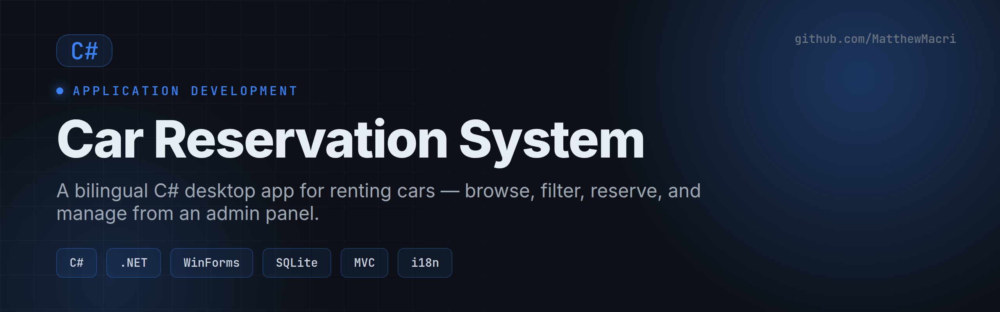

# Car Reservation System

> A bilingual C# desktop application for renting cars — customers browse, filter, and reserve, while admins manage the fleet and bookings.


Team project for **Application Development** at Vanier College — a GUI desktop app built around MVC, a data source, internationalization, and a test-driven workflow.

---

## Overview

The Car Reservation System lets customers reserve rental cars and gives administrators the tools to manage the fleet. It demonstrates object-oriented design with class hierarchies (`User → Customer / Admin`), persistent storage, LINQ data processing, and a GUI that supports **English and French** through internationalization (I18N / L10N).

## Features

### 👤 Customers
- Browse available cars and filter by type, brand, or availability
- Reserve a car for a specific date/time range
- View current and past reservations

### 🛠️ Admins
- Add, update, or remove cars from the fleet
- View all reservations across customers
- Confirm, cancel, or modify reservation statuses

### ⚙️ Under the hood
- **MVC architecture** separating model, view, and controller
- **Class hierarchies** — an abstract `User` with `Customer` and `Admin` subclasses
- **Data source** for persisting cars and reservations
- **Internationalization** — switchable English / French UI
- **Collections & LINQ** for filtering and querying data
- **Unit tests** following a test-driven approach

## Tech Stack

| Area | Tools |
|------|-------|
| Language | C# |
| Runtime | .NET |
| UI | Windows Forms (GUI desktop) |
| Data | SQLite / file-backed store |
| Patterns | MVC, OOP class hierarchies |
| Quality | Unit tests (TDD) |

## Getting Started

This is a .NET desktop application — open it in **Visual Studio** (or build with the .NET CLI):

```bash
git clone https://github.com/MatthewMacri/Application-Development-Project.git
cd Application-Development-Project

# With the .NET SDK installed:
dotnet restore
dotnet build
dotnet run
```

Or open the solution in Visual Studio and press **Run** ▶.

## Project Structure

```
.
├── Deliverable 1/           # Project description & UML diagrams
├── Deliverable 2/           # 50% checkpoint — core classes & data
├── Deliverable 3/           # Final application & user manual
├── ProjectDescription.md    # Assignment brief
└── Final_Project_Analysis.md
```

## Author

**Matthew Macri** (team project) — [LinkedIn](https://www.linkedin.com/in/m-macri/) · [GitHub](https://github.com/MatthewMacri)
